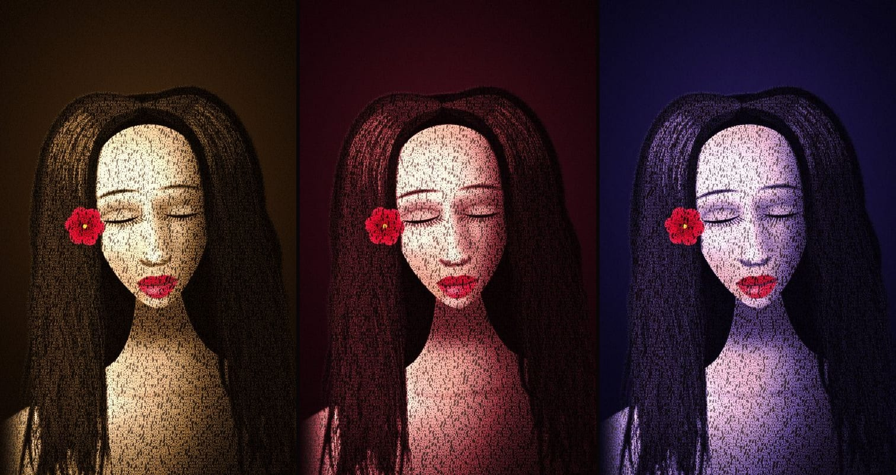

# A Portrait Made of Songs

**English** · [Español](#español)

A page to give someone as a gift: their face, drawn with nothing but the lyrics of their favorite songs.

<!-- Add your demo link here -->



Thousands of words flow across the screen and the weight of each stroke changes with the photo, so the face appears in the weight of the text. Up close, all of it is readable.

- **The letters fall** and settle until they form the face.
- **Each song has its own color**, and the portrait rewrites itself with its lyrics as you scroll.
- **The verse you're reading lights up** inside the image.
- **A lens** lets you read the words with your cursor or by tapping the screen.
- **At the end the letters dissolve** like ash and the real photo appears, along with your dedication.

It's plain HTML, CSS and JavaScript, with nothing to install or build.

## Make it yours

You only need to change three things:

**1. Your photo.** Put it in the `content/` folder. It works best when it's vertical and the face is well lit.

**2. Your lyrics.** Create one `.txt` file per song in `content/` and paste the lyrics as they are: one verse per line, with a blank line between stanzas. Tags like `[Chorus]` are ignored automatically.

**3. The `config.js` file.** This is the only file you need to edit:

```js
window.PORTRAIT = {
  name: "Anna",
  photo: "content/anna.jpg",
  songs: [
    { title: "Song title", artist: "Artist", lyrics: "content/song1.txt", listen: "" },
    // add as many as you like, they don't have to be three
  ],
  // ...plus the page text, including your dedication
};
```

> **Important:** when you change the photo, delete the `mask` line from `config.js`. Without it, the page finds the person on its own and separates them from the background. If there's nobody in the photo, it uses a soft oval instead.

The sample content is made up: the image is painted with code, and neither the songs nor the artists exist. Delete it once you add yours.

### Optional settings

| Setting | What it does |
| --- | --- |
| `palette` | Three colors per song: `[shadows, midtones, highlights]` |
| `listen` | Link to the song. Left empty (`""`), the button searches for it on Spotify. With `false`, there's no button |
| `mask` | Your own cutout: a black and white image where white = person. Useful for removing something the detector keeps, like a phone or a hand |
| `options.density` | `1.2` makes the letters smaller and adds detail |
| `options.uppercase` | `false` keeps the letters as they're written |
| `options.flow` | Text speed. `0` keeps it still |

To change the title shown when you share the link (on WhatsApp, for example), edit `<title>` and `description` in `index.html`.

## Publish it on GitHub Pages

1. Fork this repository, or upload these files to one of your own.
2. In the repository, go to **Settings → Pages**.
3. Under **Source**, choose **Deploy from a branch**, then the `main` branch and the `/ (root)` folder, and click **Save**.
4. In a minute or two it will be live at `https://YOUR-USERNAME.github.io/REPOSITORY-NAME/`.

## Preview it on your computer

Double-clicking `index.html` won't work, because browsers block reading local files. Open a terminal in this folder and run:

```bash
npx serve
```

## Before you publish

- **Capitalization matters.** On Windows, `Photo.jpg` and `photo.jpg` are the same file, but not on GitHub Pages. If something works on your computer and fails online, this is almost always why. The page will tell you which file it couldn't find.
- **The page is public.** With a free GitHub account, anyone with the link can see the photo, and the repository too. Ask for permission before publishing someone else's photo.
- **Lyrics are copyrighted.** This repository deliberately includes no real lyrics. Keep that in mind if you publish yours.

## How it works

| File | What it does |
| --- | --- |
| `config.js` | All of your content |
| `assets/js/portrait.js` | The portrait: draws the letters on the GPU with WebGL2 |
| `assets/js/sdf.js` | Turns each letter into a distance field |
| `assets/js/automask.js` | Detects the person with MediaPipe, inside the browser |
| `assets/js/main.js` | Builds the page and connects scrolling and the cursor |

- **The typographic halftone.** Each letter is stored as a distance field, meaning how far every point is from its edge. That's why the shader can thicken or thin it pixel by pixel based on the light in the photo, and why the lens magnifies it without pixelation.
- **Real color.** Anything with strong color in the photo keeps its tone in every palette, and the rest takes on the song's colors. That's why the lips and flower in the sample stay red.
- **Automatic framing.** The page analyzes the photo to locate the head and adjust contrast, so it works with any image and screen.
- **Performance.** Each letter is a small quad on the GPU, and its empty area is discarded before the photo is read. That's how it moves tens of thousands of letters, even on a phone.
- **Privacy.** Detection runs in the visitor's browser, so the photo isn't sent to any server. If you don't use `mask`, though, the browser downloads the detector from jsDelivr and Google the first time.
- **Accessibility.** It respects the reduced motion setting, the lyrics are real text, and without WebGL2 the page still works with the photo as a background.

---

## Español

Una página para regalarle a alguien: su cara, dibujada solo con las letras de sus canciones favoritas.

### Hazlo tuyo

Solo tienes que cambiar tres cosas:

**1. Tu foto.** Ponla en la carpeta `content/`. Funciona mejor si es vertical y la cara se ve bien iluminada.

**2. Tus letras.** Crea un `.txt` por canción en `content/` y pega la letra tal cual: un verso por línea y una línea en blanco entre estrofas. Las etiquetas como `[Chorus]` se ignoran solas.

**3. El archivo `config.js`.** Es el único archivo que hay que editar. Ahí pones el nombre, la foto, las canciones y todos los textos de la página, que puedes escribir en español:

```js
window.PORTRAIT = {
  name: "Ana",
  photo: "content/ana.jpg",
  songs: [
    { title: "Nombre de la canción", artist: "Artista", lyrics: "content/cancion1.txt", listen: "" },
    // agrega las que quieras, no tienen que ser tres
  ],
  // ...y los textos de la página, incluida tu dedicatoria
};
```

> **Importante:** al cambiar la foto, borra la línea `mask` de `config.js`. Sin esa línea, la página detecta a la persona sola y la separa del fondo. Si en la foto no hay nadie, usa un óvalo suave.

El contenido de ejemplo es inventado: la imagen está pintada por código y ni las canciones ni los artistas existen. Bórralo cuando pongas el tuyo.

### Ajustes opcionales

| Ajuste | Para qué sirve |
| --- | --- |
| `palette` | Tres colores por canción: `[sombras, medios, luces]` |
| `listen` | Enlace a la canción. Vacío (`""`), el botón la busca en Spotify. Con `false` no hay botón |
| `mask` | Tu propio recorte: imagen en blanco y negro donde blanco = persona. Sirve para quitar algo que el detector deja, como un teléfono o una mano |
| `options.density` | `1.2` hace las letras más pequeñas y da más detalle |
| `options.uppercase` | `false` usa las letras tal como están escritas |
| `options.flow` | Velocidad del texto. `0` lo deja quieto |

Para cambiar el título que se ve al compartir el enlace (por ejemplo en WhatsApp), edita `<title>` y `description` en `index.html`.

### Publicarlo en GitHub Pages

1. Haz un fork de este repositorio, o sube estos archivos a uno tuyo.
2. En el repositorio entra a **Settings → Pages**.
3. En **Source** elige **Deploy from a branch**, luego la rama `main` y la carpeta `/ (root)`, y pulsa **Save**.
4. En uno o dos minutos estará en `https://TU-USUARIO.github.io/NOMBRE-DEL-REPO/`.

### Verlo en tu computadora

Con doble clic en `index.html` no funciona, porque los navegadores no dejan leer archivos locales. Abre una terminal en esta carpeta y ejecuta:

```bash
npx serve
```

### Antes de publicar

- **Las mayúsculas cuentan.** En Windows `Foto.jpg` y `foto.jpg` son el mismo archivo, pero en GitHub Pages no. Si algo funciona en tu computadora y falla en línea, casi siempre es esto. La página te dirá qué archivo no encontró.
- **La página es pública.** Con una cuenta gratuita de GitHub, cualquiera con el enlace puede ver la foto, y el repositorio también. Pide permiso antes de publicar la foto de otra persona.
- **Las letras tienen derechos de autor.** Este repositorio no incluye letras reales a propósito. Ten eso en cuenta si publicas las tuyas.
